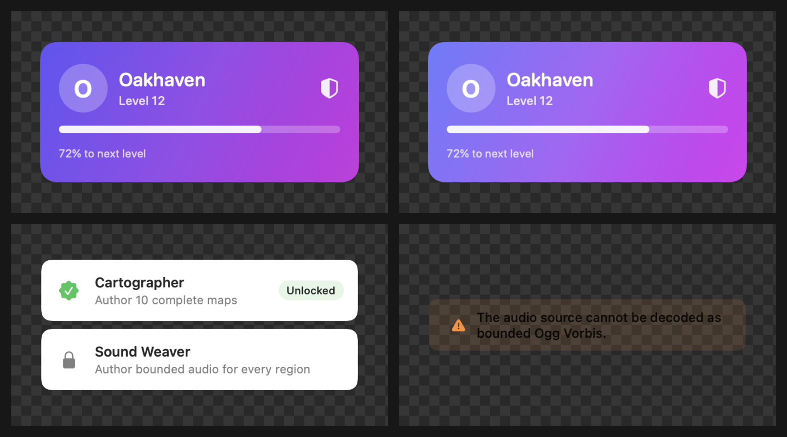

<div align="center">

# 📸 Snap

**Snapshot every Xcode preview on macOS — with zero test code.**

[](https://github.com/cafecito-games/Snap/actions/workflows/ci.yml)
[](https://swiftpackageindex.com/cafecito-games/Snap)
[](https://swiftpackageindex.com/cafecito-games/Snap)
[](LICENSE)

</div>

Snap discovers the SwiftUI previews in your built modules — both `#Preview`
macros and `PreviewProvider` types — turns each one into a real XCTest method,
renders it offscreen, and gives you the pixels: attached to the test result in
Xcode, or exported to disk as PNG + JSON metadata for any visual regression
workflow.

You write **no test methods, no image assertions, no device definitions**.
Write previews like you already do; Snap makes them executable artifacts.

```swift
import SnapTests

final class MyModulePreviewTests: SnapTest {}
// → 1 XCTest method per #Preview in your module, each rendering a PNG
```

<p align="center">
  
</p>

*Every image above is real output from the
[`Examples/DemoApp`](Examples/DemoApp) module, exported by one empty `SnapTest`
subclass.*

---

## How Snap fits in your workflow

| | |
|---|---|
| **Local, in Xcode** | Run your `SnapTest` class; every preview appears as a test with its PNG attached to the `.xcresult`. Failing previews (missing `@EnvironmentObject`, crashing layout) fail the test. |
| **CI, fast feedback** | Inherit from `SnapLayoutTest` instead — lays out every preview without pixel capture, catching crashes for a fraction of the cost. |
| **CI, visual diffing** | Set `SNAPSHOTS_EXPORT_DIR`; Snap writes one PNG + one JSON sidecar per preview — a self-describing artifact directory you can diff with any tool. |

## Installation

**Xcode:** add the package `https://github.com/cafecito-games/Snap` to your
project, then link products to targets:

- Your **XCTest target** → `SnapTests`
- The target that **declares the previews** (your app or feature module) → `SnapPreferences`, *optional*, only if you use the per-preview modifiers

**Package.swift:**

```swift
dependencies: [
    .package(url: "https://github.com/cafecito-games/Snap", from: "0.1.0"),
]
```

### Binary distribution (no compilation)

If you would rather not compile Snap at all — for example on CI runners
without package caches — use the `binary` branch, whose manifest resolves
every product to the prebuilt, library-evolution-enabled XCFrameworks
attached to the latest release:

```swift
dependencies: [
    .package(url: "https://github.com/cafecito-games/Snap", branch: "binary"),
]
```

For a pinned binary dependency, use the semver pre-release tags published
alongside each release:

```swift
.package(url: "https://github.com/cafecito-games/Snap", exact: "0.0.1-binary")
```

Imports are identical in both distributions; the binary artifacts are
verified in CI by running the [DemoApp](Examples/DemoApp) preview tests
against the freshly built frameworks.

The supported library and gallery require macOS 15+, Xcode 26, and Swift 6.
Experimental UIKit discovery, rendering, and XCTest support targets iOS 26+;
[`Examples/UIKitExample`](Examples/UIKitExample) is the app-hosted validation
project. The UIKit gallery shell is not implemented yet.

## Generating snapshots

Create a test class that inherits from `SnapTest`. There are no test methods
to write — they are generated at runtime, one per discovered preview:

```swift
import SnapTests
import EditorWorkspace

final class EditorWorkspacePreviewTests: SnapTest {

    // Optional: render only previews whose names match these regex patterns.
    // `nil` (the default) renders every preview.
    override class func includedPreviews() -> [String]? {
        nil
    }

    // Optional: exclude previews whose names match these regex patterns.
    override class func excludedPreviews() -> [String]? {
        nil
    }

    // Optional: restrict discovery to these modules.
    override class func includedModules() -> [String]? {
        ["EditorWorkspace"]
    }

    // Optional: exclude these modules from discovery.
    override class func excludedModules() -> [String]? {
        nil
    }
}
```

Run it, and each preview shows up as a readable test:

```
Test Case '-[EditorWorkspacePreviewTests test Project Processing/Regular 0]' passed
Test Case '-[EditorWorkspacePreviewTests test Project Processing/Dark 1]' passed
Test Case '-[EditorWorkspacePreviewTests test Content Browser Row/Selected 2]' passed
...
```

By default each render is attached to the test result as a PNG. Click any test
in Xcode's report navigator to see the image.

**How previews are named.** `#Preview` previews are named
`Module/File.swift:Display Name`; `PreviewProvider` previews by their
fully-qualified type name. Both forms are treated as regular expressions by
the name filters. In exported file names, an unnamed `#Preview` falls back to
its source line — for example
`EditorWorkspace_WorkspaceView.swift_line-42.png` — so every export has a
stable, collision-free name across runs.

### Layout-only checks

Inherit from `SnapLayoutTest` to exercise every preview's layout without
capturing pixels. It runs much faster and still catches crashes such as a
missing `@EnvironmentObject`, giving you *preview coverage* without image
cost:

```swift
final class EditorWorkspaceLayoutTests: SnapLayoutTest {}
```

## Exporting snapshots for CI

Set `SNAPSHOTS_EXPORT_DIR` on the test invocation to write images and
metadata directly to disk instead of the `.xcresult` bundle:

```shell
TEST_RUNNER_SNAPSHOTS_EXPORT_DIR="$PWD/snapshot-images" \
xcodebuild test \
  -scheme MyApp \
  -destination 'platform=macOS'
```

The `TEST_RUNNER_` prefix is how `xcodebuild` forwards an environment variable
into the test runner process; Snap reads the variable without the prefix.
Encoding happens on a background queue and is drained when the test bundle
finishes, so rendering one preview never waits on the previous one's PNG
compression.

For every rendered preview, two files are written:

- **`<name>.png`** — the rendered preview image at the display's backing scale
- **`<name>.json`** — a metadata sidecar:

| Field | Description |
| --- | --- |
| `display_name` | Snapshot name shown downstream, from the preview's display name. |
| `group` | Grouping key derived from the declaring file (or type). |
| `diff_threshold` | Allowed visual difference, from `.snapDiffThreshold(...)`. |
| `tags` | Key-value tags, from `.snapTags(...)`. |
| `context` | Test name, preview metadata (file, line, color scheme, …), and any custom context. |

The export directory is self-describing and stable across runs: deterministic
file names make before/after comparison a plain directory diff, while the
sidecars carry the identity and provenance of every image — source file and
line, display name, grouping key, tags, and thresholds — so downstream tooling
can group, filter, and evaluate snapshots without knowing anything about where
they came from.

### Example sidecar

```json
{
  "context" : {
    "fixture" : "vorbis-refusal",
    "preview" : {
      "container_display_name" : "demo views",
      "container_type_name" : "DemoKit.$s7DemoKit0020DemoViewsswift_odAJdfMX184_0_08_8FA...",
      "display_name" : "Sync Banner Failed",
      "index" : 0,
      "line" : 185,
      "orientation" : "portrait"
    },
    "test_name" : "-[DemoKitPreviewTests test Sync Banner Failed 3]"
  },
  "diff_threshold" : 0.02,
  "display_name" : "Sync Banner Failed",
  "group" : "DemoKit\/DemoViews.swift",
  "tags" : { "screen" : "sync", "severity" : "error" }
}
```

### Listing image names without rendering

For selective-testing workflows, set `SNAPSHOTS_ALL_IMAGE_NAMES_FILE` to write
the logical `.png` file names of every discovered preview to a file, skipping
rendering entirely. Feed that list back as `includedPreviews()` patterns (for
example through an environment variable your subclass reads) to re-render only
a chosen subset. This mode is mutually exclusive with
`SNAPSHOTS_EXPORT_DIR`.

## Browsing previews in Snap Gallery

Link the `SnapGallery` product to a trusted internal macOS app to browse the
SwiftUI previews compiled into that process. The gallery groups previews by
module and declaring file or provider, renders a lazy thumbnail contact sheet,
and opens the selected preview as a fresh, interactive SwiftUI view.

```swift
import SnapGallery
import SwiftUI

struct DeveloperToolsView: View {
    var body: some View {
        SnapGallery {
            Discover(from: EditorWorkspaceView.self)
            Discover(
                "DesignSystem",
                including: ["Button", "Field"]
            )
        }
    }
}
```

Prefer `Discover(from:)` with an existing public type—or a dedicated empty
marker type—from the module. This form is checked by the compiler, follows
renames, and keeps the module linked into the gallery host. The string form is
available for dynamic configurations. Optional `including` and `excluding`
values are regular expressions matched against preview names. Overlapping
rules are combined without duplicating stories; `Discover()` includes previews
from every linked module.

The host app must link or reference every module whose previews it should show.
Use a Debug-like build configuration: optimized builds may remove preview
declarations and runtime metadata. Only expose the gallery in trusted internal
builds because previews can contain unfinished UI, fixtures, and development
data.

Run the repository example with:

```shell
xcrun swift run --package-path Examples/DemoApp DemoGallery
```

## Customizing previews

Link the target that declares your previews to `SnapPreferences` and annotate
individual previews:

```swift
import SnapPreferences

#Preview("Map") {
    MapPreview()
        .snapTags(["screen": "map"])
        .snapAdditionalContext(["fixture": "city-route"])
        .snapDiffThreshold(0.05)
}
```

| Modifier | Use it when | Effect on the snapshot |
| --- | --- | --- |
| `.snapDiffThreshold(0.05)` | A preview has small expected pixel differences. | Allows up to 5% changed pixels before being flagged downstream. |
| `.snapTags(["area": "checkout"])` | You want searchable labels. | Adds top-level `tags` to the sidecar. Repeated modifiers merge; later keys win. |
| `.snapAdditionalContext(["fixture": "loaded"])` | You want extra sidecar metadata. | Adds fields to the sidecar `context`. Strings, booleans, finite numbers, and nested dictionaries are supported; custom keys override generated ones. |
| `.snapRenderingMode(.layer)` | The default capture mis-renders content. | Captures through the layer tree instead of `NSView.cacheDisplay`. |

## Tips for good snapshots

- **Give every preview a unique display name.** It becomes the test name, the
  exported file name, and the sidecar `display_name`. (Snap disambiguates
  duplicates, but unique names read far better.)
- **Keep previews deterministic.** Avoid live network calls, timers,
  animations that never settle, and clock-derived dates, so the same preview
  produces the same pixels in Xcode, locally, and in CI.
- **Detect the snapshot environment** in app code with one check:

  ```swift
  extension ProcessInfo {
      var isRunningSnapshots: Bool {
          environment["SNAPSHOTS_RUNNING_FOR_PREVIEWS"] == "1"
      }
  }
  ```

  Set `SNAPSHOTS_RUNNING_FOR_PREVIEWS=1` in the scheme that runs your Snap
  tests, and disable preview-unfriendly behavior (logging, analytics,
  networking) while it is set.

## How it works

No source rewriting, no build plugins — Snap works from the compiled binary:

1. **Discovery.** At test-enumeration time, Snap scans the
   `__swift5_proto` sections of every non-system image loaded in the test
   process for protocol conformances to SwiftUI's `PreviewProvider` and
   DeveloperToolsSupport's `PreviewRegistry` — the protocol the `#Preview`
   macro expands to. For each conformance it reconstructs the declaring type
   from Swift runtime metadata.
2. **Extraction.** `PreviewProvider` declares several children in
   `static var previews`; Snap selects each child individually through
   SwiftUI's variadic view tree. `#Preview` bodies live behind
   DeveloperToolsSupport types that are not visible to source compilation, so
   Snap reaches the view through runtime reflection instead.
3. **Test generation.** Snap registers one XCTest method per preview through
   the Objective-C runtime, backed by a tiny ObjC shim that constructs the
   `NSInvocation`s XCTest requires (they cannot be built from Swift).
4. **Rendering.** Each preview is hosted in an offscreen, borderless
   `NSHostingController`, sized with `sizeThatFits`, allowed one run-loop turn
   to settle, and captured with `NSView.cacheDisplay`. A
   `.preferredColorScheme(.dark)` inside a preview is detected and re-applied
   as an environment override, matching what the Xcode canvas shows.

Rendering runs inside the plain XCTest process — no host application required —
which is why this works for ordinary unit-test bundles.

## Scope and limitations

- macOS is the primary supported platform. Experimental iOS/iPadOS discovery,
  rendering, and simulator tests target the current and previous major OS
  versions; the native UIKit gallery is still roadmap work.
- SwiftUI previews only (`#Preview` and `PreviewProvider`). Previews that wrap
  `NSView` content are not rendered by the macOS backend.
- Window-capture rendering is not ported: `CGWindowListCreateImage` was
  obsoleted in macOS 15, and its replacement (ScreenCaptureKit) requires
  asynchronous capture and screen-recording permissions.
- Accessibility overlays and the inserted-dylib accessibility test flow from
  SnapshotPreviews (see below) are not ported.

Snap is a macOS-focused reimplementation of
[getsentry/SnapshotPreviews][upstream] by EmergeTools, rebuilt as a pure
source package — no prebuilt frameworks — for the needs of the
[UzirEdit][uziredit] editor. See `LICENSE` for attribution.

## Development

See [`ROADMAP.md`](ROADMAP.md) for the product milestones, platform tiers,
release gates, and current issue order.

```shell
xcrun swift test          # unit tests + end-to-end fixture rendering
SNAPSHOTS_EXPORT_DIR=/tmp/snap-export xcrun swift test   # exercise the export flow
```

A complete consumer example lives in [`Examples/DemoApp`](Examples/DemoApp):
a small module with five `#Preview` declarations, a one-class `SnapTest`
suite, and per-preview `SnapPreferences` modifiers. Run its export flow with:

```shell
SNAPSHOTS_EXPORT_DIR=/tmp/demo-snapshots xcrun swift test --package-path Examples/DemoApp
```

### Troubleshooting: `plugin for module 'PreviewsMacros' not found`

Always build with `xcrun swift ...`, not bare `swift`. The `#Preview` macro
plugin (`PreviewsMacros`) ships inside Xcode's platform directory — it is not
part of the command-line tools or standalone toolchains such as swiftly. If
`swift test` fails with

```
external macro implementation type 'PreviewsMacros.SwiftUIView' could not be
found for macro 'Preview(_:body:)'; plugin for module 'PreviewsMacros' not found
```

your PATH resolves `swift` to a standalone toolchain (check with
`which -a swift`). Run `xcrun swift test`, which selects the active Xcode
toolchain via `xcode-select`, or switch that shell to Xcode's toolchain.

## Contributing

Issues and pull requests are welcome. For code changes:

- Match the existing style; builds must stay warning-free.
- Add a focused regression test under `Tests/SnapTestsTests` for every
  behavior change, and run the full suite before submitting.
- Include sample exported filenames, metadata, or screenshots when snapshot
  output changes.
- Keep the macOS CI job green.

## License

[MIT](LICENSE) — with retained attribution to
[getsentry/SnapshotPreviews][upstream], from which this project is derived.

[upstream]: https://github.com/getsentry/SnapshotPreviews
[uziredit]: https://github.com/cafecito-games/UzirEdit
